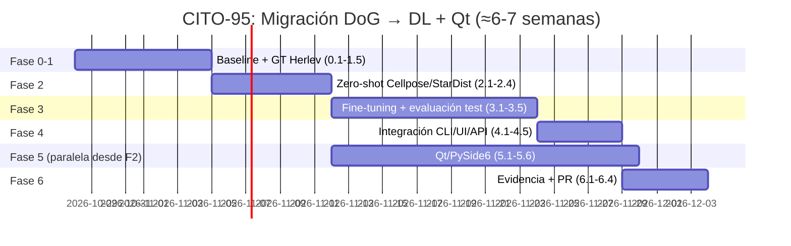

# Plan de Migración: DoG → Deep Learning + Qt/PySide6 (CITO-95)

**Fecha:** 2026-10-28
**Objetivo:** F1 ≥ 90% en imágenes reales Papanicolaou/EDF con ground truth experto, y app clínica en Qt/PySide6.
**Principio rector:** reutilizar al máximo lo existente; validar con datos que ya están en el repo antes de anotar nada nuevo.

---

## 0. Estado real del repositorio (verificado 2026-10-28)

| Activo | Estado | Implicación para el plan |
|---|---|---|
| `data/raw/im_Dyskeratotic/` | **Dataset Herlev**: 813 crops con `*_nuc.dat` / `*_cyt.dat` (polígonos x,y expertos) + imágenes completas con múltiples anotaciones | ✅ **Ground truth experto YA EXISTE** — no bloquea el arranque |
| `data/ground_truth/` | Vacío (solo README con formato previsto) | ⚠️ Las métricas actuales NO usan GT espacial real |
| `data/raw/train|val|test/` | Vacíos (0 imágenes, 0 etiquetas) | ⚠️ Los splits YOLO previos eran sintéticos |
| `data/sintetico/` | 20 imágenes + etiquetas YOLO (cajas) | Solo sirve para smoke tests, no para F1 clínico |
| `evaluar_cito23.py` | Precision/Recall/F1/IoU con emparejamiento por centroides | ♻️ Reutilizable casi intacto para evaluar DL |
| `src/` (preprocessing, dog_filter, analysis, visualization) | Pipeline funcional, funciones en español, tipado | ♻️ Reutilizable como baseline y como preprocesamiento |
| `tests/` (202 tests) | Suite verde | ♻️ Base para tests de regresión del nuevo pipeline |
| `app.py` (Streamlit), `api_v1.py` | UI y API funcionales | ♻️ Referencia de paridad; se migran a Qt después |
| `requirements.txt` | torch/cellpose/stardist comentados, listos | ♻️ Solo descomentar y fijar versiones |
| Métrica F1≈0.93 reportada | Sobre datos **sintéticos** | ⚠️ No es evidencia clínica; el objetivo real es F1≥90% en Herlev/EDF |

**Conclusión clave:** el cuello de botella no es la anotación (Herlev la trae), sino (a) convertir `.dat` → máscaras, (b) elegir y ajustar el modelo, (c) evaluar con el mismo protocolo de métricas que ya existe.

---

## Fase 0 — Preparación y línea base (2-3 días)

| # | Actividad | Entregable | Criterio de salida |
|---|---|---|---|
| 0.1 | Sincronizar rama: `git fetch origin --prune && git status -sb`; resolver desfase con `origin/Rama-DeTrabajo` | Rama `CITO-95-dl-migracion` limpia | Sin commits pendientes ajenos |
| 0.2 | Congelar baseline DoG actual sobre Herlev: correr `main.py`/`evaluar_cito23.py` sobre las imágenes completas de `im_Dyskeratotic` | `data/results/CITO-95-baseline-dog.csv` + resumen | F1 baseline documentado (aunque sea bajo) |
| 0.3 | Crear entorno DL aislado (venv/conda) y descomentar dependencias en `requirements.txt` con versiones fijadas | `requirements-dl.txt` | `python verificar_entorno.py` pasa; import de torch/cellpose OK |
| 0.4 | Bitácora: registrar en `bitacora_experimentos.csv` el experimento CITO-95 con versión, dataset, parámetros, fecha | Fila en bitácora | Trazabilidad según convención del repo |

> Nota: no cambiar varios parámetros a la vez durante calibración (regla del repo). El baseline se congela antes de tocar nada.

---

## Fase 1 — Ground truth utilizable desde Herlev (3-5 días)

| # | Actividad | Entregable | Criterio de salida |
|---|---|---|---|
| 1.1 | Módulo `src/herlev_dataset.py`: leer `*_nuc.dat`/`*_cyt.dat` (polígonos) y rasterizar a máscaras binarias con `cv2.fillPoly` | Funciones `cargar_poligonos_nucleo()`, `rasterizar_mascara()` | Test unitario: máscara de `001_01` tiene área > 0 y coincide con el polígono |
| 1.2 | Convertidor a formato de evaluación: máscaras PNG + CSV de centroides/áreas por imagen (mismo esquema que `data/ground_truth/README.md` ya define) | `data/ground_truth/herlev/` (máscaras + `*_cells.csv`) | `validar_consistencia_dataset.py` adaptado pasa |
| 1.3 | Splits estratificados train/val/test (70/15/15) por clase Herlev, guardados como manifiestos CSV | `data/ground_truth/herlev/splits/*.csv` | Sin fuga: crops de la misma imagen original nunca cruzan splits |
| 1.4 | Script `preparar_herlev.py` (CLI, estilo `crear_dataset.py`) que automatiza 1.1-1.3 de forma reproducible | Script + README de uso | Re-ejecutar produce hashes idénticos |
| 1.5 | **Re-evaluar baseline DoG contra este GT real** con `evaluar_cito23.py` apuntando a las nuevas máscaras | `data/results/CITO-95-baseline-dog-herlev.csv` | F1 real del DoG documentado (número honesto, probablemente < 90%) |

> ⚠️ Herlev es single-cell en CROPPED; para detección multi-célula hay que usar las imágenes completas (`001.bmp`…) con sus múltiples `*_nuc*.dat`. Verificar cobertura por clase (normal ligera/moderada, DIS, koilocitótica, metaplasia, carcinoma in situ) y documentar huecos.

---

## Fase 2 — Selección y prueba rápida de modelos DL (1 semana)

| # | Actividad | Entregable | Criterio de salida |
|---|---|---|---|
| 2.1 | **Cellpose zero-shot** (sin entrenamiento) sobre 20 imágenes de test Herlev usando `evaluar_cito23.py` | `data/results/CITO-95-cellpose-zeroshot.csv` | F1 medido con el mismo protocolo que el baseline |
| 2.2 | **StarDist preentrenado** (`2D_versatile_fluo`) igual que 2.1 | `data/results/CITO-95-stardist-zeroshot.csv` | F1 medido; comparación directa en tabla |
| 2.3 | Tabla comparativa DoG vs Cellpose vs StarDist (mismo GT, mismo emparejamiento) | `docs/CITO-95-comparacion-modelos.md` | Decisión documentada: modelo base elegido |
| 2.4 | Adaptador `src/segmentador_dl.py` con la misma interfaz de salida que `analizar_nucleos()` (dict con `contornos`, `areas`, `total_celulas`) | Módulo + tests | `tests/test_segmentador_dl.py` pasa; UI/API pueden consumirlo sin cambios |

> Criterio de decisión: si zero-shot ya da F1 ≥ 85-88%, el fine-tuning será corto. Si da < 70%, priorizar fine-tuning desde el inicio.

---

## Fase 3 — Fine-tuning / entrenamiento (1-2 semanas)

| # | Actividad | Entregable | Criterio de salida |
|---|---|---|---|
| 3.1 | Preparar datos de entrenamiento: parches 256×256 desde imágenes completas + máscaras Herlev (aumentos: rotación, flip, jitter de intensidad) | `data/processed/herlev_patches/` | Manifiesto con conteo por split y por clase |
| 3.2 | Fine-tune del modelo elegido (Cellpose con `train()` o StarDist `train()`) con semillas fijas y config versionada en `configs/cito95_model.yaml` | Pesos en `models/cito95/` + curvas de pérdida | Val F1 monótono estable; sin overfit (gap train-val < 10 pts) |
| 3.3 | Barrido mínimo de hiperparámetros (lr, epochs, diámetro/percentil) — **un parámetro a la vez**, según convención del repo | `data/calibration/cito95_barrido.csv` | Mejor config registrada en bitácora |
| 3.4 | Evaluación final en test (nunca tocado antes) con `evaluar_cito23.py` | `data/results/CITO-95-evaluacion-test.csv` + resumen | **F1 ≥ 90% en test** → criterio de éxito; si no, iterar 3.2-3.3 o revisar GT |
| 3.5 | Análisis de errores: FP/FN por clase, tamaños de núcleo, calidad de imagen | `docs/CITO-95-analisis-errores.md` | Hipótesis de mejora priorizadas |

> Fallback si F1 < 90% tras 2 iteraciones: (a) revisar calidad de rasterizado de máscaras, (b) aumentar datos con crops CROPPED como preentrenamiento, (c) U-Net (segmentation-models-pytorch) como tercer candidato.

---

## Fase 4 — Integración en el pipeline existente (3-5 días)

| # | Actividad | Entregable | Criterio de salida |
|---|---|---|---|
| 4.1 | `main.py`: flag `--motor dog|dl` manteniendo compatibilidad con flags actuales (`--lote --no-gui --sigma1 …`) | CLI actualizada | `python main.py data/raw --motor dl --lote --no-gui` funciona |
| 4.2 | `app.py` (Streamlit): selector de motor en panel de ajustes; reutiliza `src/segmentador_dl.py` | UI actualizada | Paridad de resultados con CLI en 3 imágenes de prueba |
| 4.3 | `api_v1.py`: campo `engine` en payload de `/api/v1/analyze` (validado contra whitelist) | API actualizada | `tests/test_api_v1.py` ampliado y en verde |
| 4.4 | Reglas de clasificación (regla 3x, CITO-77) aplicadas sobre áreas del modelo DL — sin cambios de lógica | Integración | `tests/test_cito77_reglas.py` sigue en verde |
| 4.5 | Suite completa: `python -m unittest discover -s tests -v` + `python validar_consistencia_dataset.py` | Evidencia en bitácora | 202 tests + nuevos, todos en verde |

---

## Fase 5 — Migración de UI a Qt/PySide6 (2-3 semanas, en paralelo desde Fase 2)

| # | Actividad | Entregable | Criterio de salida |
|---|---|---|---|
| 5.1 | Estructura `qt_app/` con separación presentación/lógica (la lógica ya vive en `src/`, no se duplica) | Esqueleto + `requirements-qt.txt` (PySide6, pytest-qt) | App vacía abre y muestra imagen |
| 5.2 | Visor de imagen con overlays (contornos normal/sospechosa/frontera, colores actuales verde/rojo/amarillo) | Widget `VisorImagen` | Renderiza resultados de `analizar_nucleos()` y de `segmentador_dl()` |
| 5.3 | Panel de parámetros equivalente al de Streamlit (σ, polaridad, motor, separación) | Widget `PanelAjustes` | Cambios de parámetro re-procesan en vivo |
| 5.4 | Dashboard de métricas (reutiliza `src/metricas_sistema.py` y `src/historial_resultados.py` tal cual) | Vista `Dashboard` | Mismos KPI que Streamlit: total, normales, sospechosas, % riesgo |
| 5.5 | Test de paridad Streamlit ↔ Qt sobre imágenes fijas | `tests/test_paridad_ui.py` | Diferencia de conteo = 0 en imágenes de prueba |
| 5.6 | Empaquetado (PyInstaller) y aviso de uso experimental en cada pantalla | Binario + capturas en `data/results/screenshots/` | Ejecutable corre offline sin Python instalado |

> Streamlit se mantiene como referencia/oráculo hasta que la paridad esté probada; no se borra.

---

## Fase 6 — Evidencia y cierre (3-5 días)

| # | Actividad | Entregable |
|---|---|---|
| 6.1 | Documento `docs/evidencia-cito95-validacion-dl.md`: dataset, GT, splits, modelo, hiperparámetros, métricas por clase, fecha, decisión | Evidencia completa según convención del repo |
| 6.2 | Gráficas: PR por clase, matriz de confusión, comparativa DoG vs DL | `data/results/graficas_tesis/` |
| 6.3 | Actualizar `README.md` y `docs/plan-proyecto.md` (enlazar, no duplicar) | Docs al día |
| 6.4 | Commit convencional: `feat(CITO-95): ...` + PR a rama de seguimiento | PR abierto |

---

## Cronograma resumido (ruta crítica)

**Tiempo total estimado: 6-7 semanas** (Fase 5 corre en paralelo con 3-4; si se hace secuencial, 8-9 semanas).

---

## Riesgos y mitigaciones

| Riesgo | Prob. | Impacto | Mitigación |
|---|---|---|---|
| Herlev cubre solo 1 clase en el repo (`im_Dyskeratotic`) | Alta | Alto | Descargar las 7 clases Herlev restantes (públicas) o complementar con EDF propio; documentar hueco en evidencia |
| Los `.dat` de imágenes completas no cubren todos los núcleos | Media | Alto | Auditoría visual de 10 imágenes antes de entrenar (Fase 1.5) |
| Zero-shot < 70% F1 | Media | Medio | Saltar directo a fine-tuning (Fase 3 ya lo contempla) |
| GPU no disponible en el entorno | Media | Medio | Cellpose/StarDist entrenan en CPU con parches pequeños; presupuestar +3-5 días |
| Qt retrasa la validación científica | Baja | Medio | Fase 5 es paralela y no bloquea F1; el criterio de éxito es científico, no de UI |
| Confundir F1 sintético (0.93) con validación clínica | — | Alto | Este plan lo corrige explícitamente: toda métrica nueva se calcula contra máscaras Herlev reales |

---

## Qué NO hacer (guardarraíles del repo)

- No publicar imágenes originales ni anotaciones brutas (`.gitignore` ya protege `data/raw/`).
- No afirmar validación clínica: los resultados son experimentales hasta revisión experta.
- No cambiar varios hiperparámetros a la vez en la calibración.
- Toda corrección de pipeline o validadores → añadir test de regresión en `tests/`.
- Commits convencionales con clave Jira: `feat(CITO-95): ...`.
